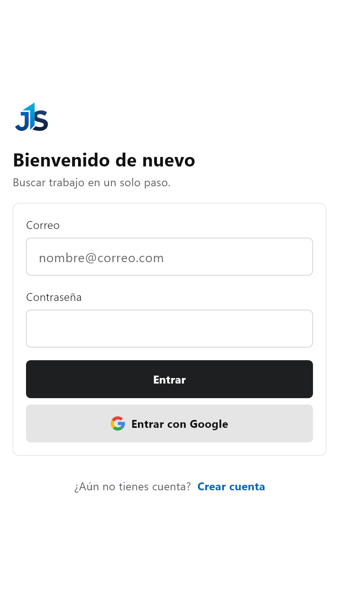
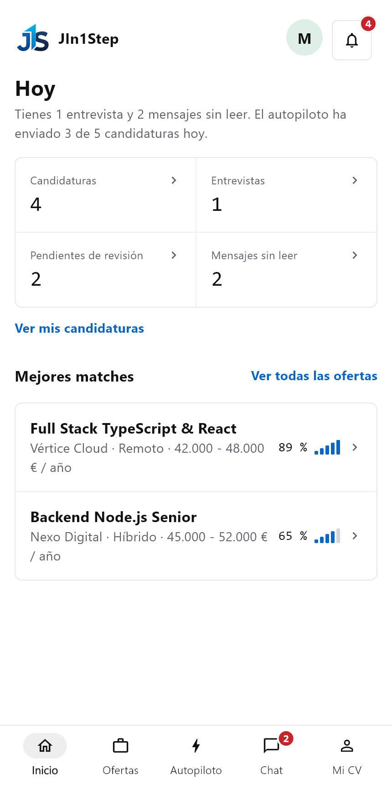
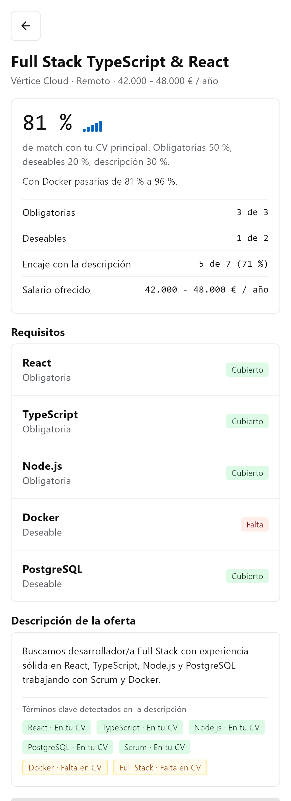
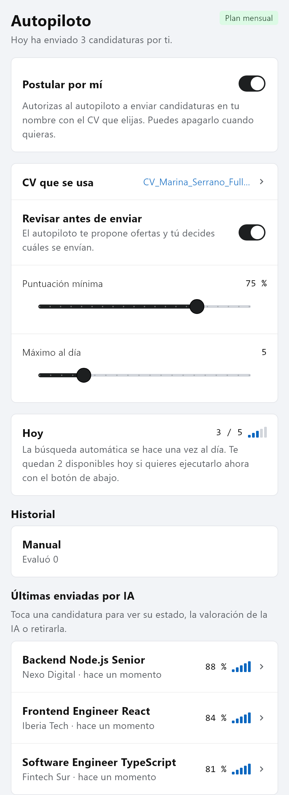
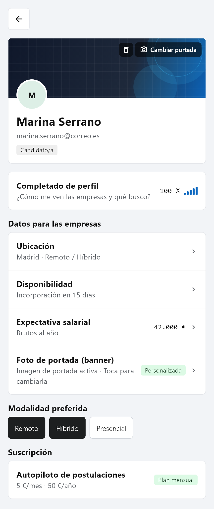
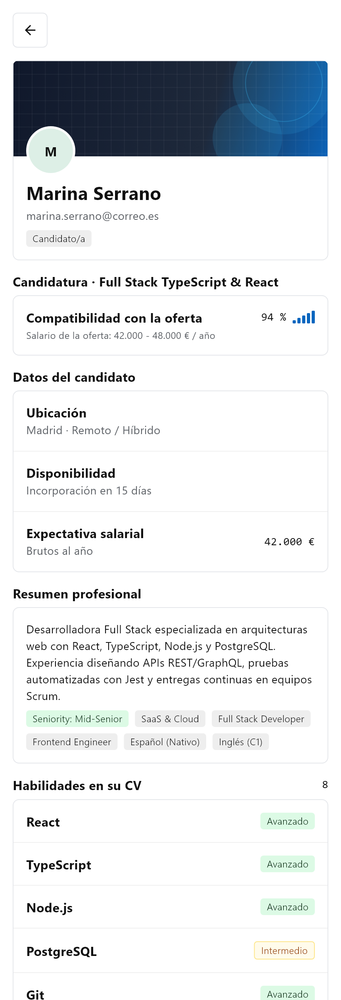

<p align="center">
  
</p>

# JIn1Step

**Buscar trabajo en un solo paso.** JIn1Step es una plataforma de empleo que conecta a
candidatos y reclutadores e incorpora un **autopiloto de postulaciones con IA**: el candidato
sube su CV una vez, el sistema detecta sus habilidades, calcula un **match híbrido** frente a los
requisitos y la descripción de cada oferta, y postula automáticamente (o propone sugerencias para
revisar antes de enviar) a las vacantes que mejor encajan con su perfil.

---

## Tabla de contenidos

- [Capturas de pantalla](#capturas-de-pantalla)
- [Qué hace la app](#qué-hace-la-app)
- [Estado del proyecto](#estado-del-proyecto)
- [Estructura del repositorio](#estructura-del-repositorio)
- [Stack tecnológico](#stack-tecnológico)
- [Base de datos](#base-de-datos)
- [API REST](#api-rest)
- [Cómo funciona el matching híbrido](#cómo-funciona-el-matching-híbrido)
- [El autopiloto](#el-autopiloto)
- [Puesta en marcha](#puesta-en-marcha)
- [Tests](#tests)
- [Decisiones de diseño](#decisiones-de-diseño)

---

## Capturas de pantalla

<table>
  <tr>
    <td align="center" width="33%">
      <br>
      <sub><b>1. Acceso y autenticación</b><br>Login con correo/contraseña y Google Sign-In</sub>
    </td>
    <td align="center" width="33%">
      <br>
      <sub><b>2. Inicio del candidato («Hoy»)</b><br>Resumen diario, 4 KPIs y mejores matches con salario</sub>
    </td>
    <td align="center" width="33%">
      <br>
      <sub><b>3. Detalle de oferta y Match Híbrido</b><br>Obligatorias (50 %), deseables (20 %) y descripción (30 %)</sub>
    </td>
  </tr>
  <tr>
    <td align="center" width="33%">
      <br>
      <sub><b>4. Autopiloto IA</b><br>Revisión previa, umbrales, cupo diario y envíos por IA</sub>
    </td>
    <td align="center" width="33%">
      <br>
      <sub><b>5. Perfil del candidato</b><br>Portada estilo LinkedIn, ubicación, disponibilidad y expectativa salarial</sub>
    </td>
    <td align="center" width="33%">
      <br>
      <sub><b>6. Vista para el reclutador</b><br>Perfil completo del candidato, resumen IA, salario y habilidades</sub>
    </td>
  </tr>
</table>

---

## Qué hace la app

JIn1Step tiene tres roles (`CANDIDATO`, `RECLUTADOR`, `ADMIN`) y gira en torno a cinco pilares:

### 1. El CV como fuente de verdad

El candidato sube su currículum en PDF. El servidor extrae el texto, calcula su `atsScore`, lo
cruza contra un catálogo cerrado de habilidades técnicas (~70 entradas: lenguajes, frameworks,
bases de datos, cloud, testing, metodologías, idiomas…) y genera además un **resumen profesional
estructurado con IA** (`perfilIa`: resumen ejecutivo, seniority, sector, roles objetivo e idiomas).
El candidato puede ajustar sus habilidades en cualquier momento y declarar su nivel
(`BASICO` / `INTERMEDIO` / `AVANZADO`).

### 2. Ofertas con requisitos explícitos y banda salarial

El reclutador crea su empresa y publica ofertas (`REMOTO` / `HIBRIDO` / `PRESENCIAL`) indicando el
**rango salarial** (`salario`) y qué habilidades pide, distinguiendo cuáles son **obligatorias** y
cuáles **deseables**.

### 3. Match híbrido (50 / 20 / 30), explicable y reproducible

Cada pareja CV ↔ oferta produce una puntuación de 0 a 100 combinando tres dimensiones:
- **50 %** requisitos obligatorios cubiertos.
- **20 %** requisitos deseables cubiertos.
- **30 %** encaje del CV con las tecnologías y palabras clave detectadas en el texto de la
  **descripción de la oferta**.

Además del porcentaje total, la app muestra el **hallazgo de mayor impacto** (*«Con Docker pasarías
de 81 % a 96 %»*) y desglosa qué términos de la descripción ya aparecen en el CV y cuáles faltan.

### 4. Autopiloto de postulaciones (con modo de revisión previa)

Con una suscripción activa (`MENSUAL` o `ANUAL`), el candidato configura qué CV usar, la puntuación
mínima y el tope diario de envíos. Puede elegir entre:
- **Envío automático**, o
- **Revisar antes de enviar** (`revisarAntes`): el autopiloto previsualiza las ofertas recomendadas
  y su valoración IA para que el candidato marque cuáles desea enviar.

### 5. Perfil profesional tipo LinkedIn y vista completa para reclutadores

- **Candidato**: cuenta con foto de portada (`banner`) personalizable desde su dispositivo,
  ubicación, disponibilidad, **expectativa salarial bruta anual** (`expectativaSalarial`) y
  preferencias de modalidad.
- **Reclutador**: puede abrir el perfil completo de cualquier candidato desde sus ofertas o desde
  el chat para consultar su portada, compatibilidad con la vacante, expectativa salarial, resumen
  profesional IA, habilidades declaradas, lectura/descarga del CV en PDF, selección para entrevista
  y chat directo en tiempo real.

---

## Estado del proyecto

| Parte | Estado |
|---|---|
| **Backend** (API REST + PostgreSQL + IA) | Funcional: 13 módulos, 15 tablas, migraciones Prisma, cron diario del autopiloto, integración con Groq LLM y fallback determinista |
| **Frontend** (app Flutter multiplataforma) | Funcional: sistema de diseño propio (`DESIGN.md` + `animation.md`), flujos completos de candidato y reclutador, y 51 tests de widgets |
| **Suscripciones y pagos** | Gestión completa de planes mensual/anual, cambio de plan, cancelación y reactivación |

---

## Estructura del repositorio

```
JIn1Step/
├── docs/
│   └── screenshots/             # Capturas de pantalla de la aplicación
│
├── jin1step/                    # Aplicación multiplataforma (Flutter · Dart)
│   ├── assets/
│   │   ├── design/              # Especificación visual (DESIGN.md y animation.md)
│   │   └── images/              # Logotipos de marca
│   ├── lib/
│   │   ├── core/                # Cliente HTTP (Dio + JWT), tema y tokens de diseño
│   │   ├── screens/             # Pantallas (Home, Ofertas, OfertaDetalle, Autopiloto,
│   │   │                        #   Chat, Mi CV, Perfil, PerfilCandidato, Reclutador…)
│   │   ├── services/            # Servicios de API (Auth, Candidato, Ofertas, Chat, etc.)
│   │   ├── widgets/             # Componentes del sistema de diseño (Panel, MatchIndicator…)
│   │   └── main.dart
│   └── test/                    # Suite de 51 tests de widgets e interfaz
│
└── jin1step.server/             # API REST (Node.js · TypeScript · Express 5)
    ├── prisma/
    │   ├── schema.prisma        # Esquema de base de datos PostgreSQL
    │   ├── migrations/          # Historial de migraciones SQL
    │   └── seed-habilidades.ts  # Catálogo inicial de habilidades
    ├── src/
    │   ├── app.ts               # Configuración de Express, CORS, Helmet y rutas
    │   ├── server.ts            # Arranque del servidor y planificador cron
    │   ├── jobs/                # Tarea programada diaria del autopiloto
    │   └── modules/             # Arquitectura modular por dominio
    │       ├── auth/
    │       ├── CandidatoPerfil/ # Ubicación, disponibilidad, expectativa salarial y banner
    │       ├── cv/              # Subida de PDF, ATS score, habilidades y resumen IA
    │       ├── habilidad/
    │       ├── empresa/
    │       ├── ofertas/         # Publicación, búsqueda y rango salarial
    │       ├── postulacion/     # Postulaciones + motor de matching híbrido + IA
    │       ├── preferencias_autopilot/
    │       ├── postulaciones_autopilot/
    │       ├── conversacion/
    │       ├── mensaje/
    │       ├── notificacion/
    │       └── suscripcion/
    ├── docker-compose.yml
    └── package.json
```

---

## Stack tecnológico

**Backend**

| Pieza | Tecnología |
|---|---|
| Lenguaje | TypeScript 5.6 (Node.js, modo `strict`) |
| Framework | Express 5 |
| ORM | Prisma 6 |
| Base de datos | PostgreSQL 16 |
| Validación | Zod 4 |
| IA / LLM | Groq API (`llama-3.3-70b-versatile`) con fallback heurístico sin latencia |
| Autenticación | JWT (`jsonwebtoken`) + bcrypt + Google Identity (`google-auth-library`) |
| Subida de archivos | Multer + `pdf-parse` para extracción de texto de CVs |
| Seguridad | Helmet, CORS, `express-rate-limit` |
| Tests | Vitest |

**Frontend**

| Pieza | Tecnología |
|---|---|
| Framework | Flutter (Dart SDK ^3.10.7) |
| Tipografía | `Bricolage Grotesque` (interfaz) + `Geist Mono` (cifras tabulares y métricas) |
| Red y archivos | `dio`, `file_picker`, `shared_preferences`, `google_sign_in` |
| Plataformas | Android, iOS, Web, Windows, macOS, Linux |

---

## Base de datos

Un único motor **PostgreSQL 16** gestionado con Prisma en
[`jin1step.server/prisma/schema.prisma`](jin1step.server/prisma/schema.prisma).

### Tablas principales

| Tabla | Propósito |
|---|---|
| `usuarios` | Cuentas (`CANDIDATO`, `RECLUTADOR`, `ADMIN`), hash bcrypt y/o `google_id` |
| `candidatos_perfil` | Perfil profesional 1:1: `ubicacion`, `disponibilidad`, `expectativa_salarial` (€/año) y `banner` (imagen de portada) |
| `empresas` | Empresas creadas por los reclutadores |
| `cvs` | Currículums en PDF, texto extraído, `ats_score` y `perfil_ia` (JSON) |
| `habilidades` | Catálogo normalizado de habilidades técnicas, metodologías e idiomas |
| `cv_habilidades` | Habilidades asociadas a cada CV con su `NivelHabilidad` |
| `ofertas` | Vacantes con título, descripción, modalidad, `salario` y `EstadoOferta` |
| `oferta_requisitos` | Habilidades requeridas por oferta (`obligatorio: true | false`) |
| `postulaciones` | Candidaturas con `match_score`, `postulado_por_ia`, `puntuacion_ia`, `motivo_ia` y `carta_ia` |
| `preferencias_autopilot` | Configuración por candidato (`activo`, `revisar_antes`, `cv_id`, `score_minimo`, `max_por_dia`) |
| `ejecuciones_autopilot` | Registro de auditoría de cada ejecución manual o automática del autopiloto |
| `conversaciones` / `mensajes` | Mensajería directa candidato ↔ reclutador con estado de lectura |
| `notificaciones` | Alertas de actividad, entrevistas y envíos del autopiloto |
| `suscripciones` | Estado e historial de planes de suscripción (`MENSUAL` / `ANUAL`) |

---

## API REST

Base: `http://localhost:3000/api` · Autenticación: `Authorization: Bearer <accessToken>`

| Método | Ruta | Rol | Descripción |
|---|---|---|---|
| `GET` | `/health` | — | Estado del servidor |
| `POST` | `/auth/register` · `/auth/login` · `/auth/login/google` | — | Registro e inicio de sesión |
| `GET` · `PUT` | `/perfil-candidato/mio` | candidato | Consultar o actualizar ubicación, disponibilidad, expectativa salarial y banner |
| `POST` · `DELETE` | `/perfil-candidato/mio/banner` | candidato | Subir o eliminar la foto de portada tipo LinkedIn |
| `GET` | `/perfil-candidato/:candidatoId` | reclutador | Ver el perfil completo, resumen IA y CVs de un candidato |
| `POST` · `GET` · `DELETE` | `/cv` · `/cv/:id` | auth | Subir, listar, consultar o borrar CVs en PDF |
| `GET` · `POST` · `PATCH` · `DELETE` | `/habilidades/cv/:cvId` | candidato | Gestionar habilidades y niveles de un CV |
| `GET` · `POST` · `PATCH` | `/ofertas` · `/ofertas/mias` · `/ofertas/:id` | auth / reclutador | Buscar, publicar y editar ofertas con salario y requisitos |
| `POST` | `/postulaciones` | candidato | Postularse a una oferta calculando match híbrido |
| `POST` | `/postulaciones/simular-match` | candidato | Simular puntuación y desglose sin postularse |
| `GET` | `/postulaciones/mias` | candidato | Historial de candidaturas del usuario |
| `GET` · `PATCH` | `/postulaciones/oferta/:ofertaId` · `/postulaciones/:id` | reclutador | Listar candidatos de una oferta y actualizar estado (`ENTREVISTA`, etc.) |
| `GET` · `PATCH` | `/preferencias-autopilot` | candidato | Configurar el autopiloto |
| `POST` | `/postulaciones-autopilot/previsualizar` | candidato | Previsualizar ofertas sugeridas antes de enviar |
| `POST` | `/postulaciones-autopilot/ejecutar` | candidato | Ejecutar el autopiloto (todas o selección revisada) |
| `GET` | `/postulaciones-autopilot/historial` | candidato | Historial de pasadas del autopiloto |
| `GET` · `POST` | `/conversaciones` · `/conversaciones/:id/mensajes` | candidato · reclutador | Bandeja de entrada y envío de mensajes |
| `GET` · `POST` · `PATCH` | `/suscripciones/mia` · `/suscripciones/activar-demo` · `/suscripciones/plan` | candidato | Gestión de la suscripción al autopiloto |

---

## Cómo funciona el matching híbrido

El cálculo de compatibilidad ([`matching.service.ts`](jin1step.server/src/modules/postulacion/matching.service.ts) y [`oferta_detalle.dart`](jin1step/lib/screens/oferta_detalle.dart)) evalúa tanto los requisitos estructurados como el texto libre de la descripción:

$$\text{matchScore} = (\text{Obligatorias} \times 0{,}50) + (\text{Deseables} \times 0{,}20) + (\text{Descripción} \times 0{,}30)$$

- **Redistribución automática de pesos**: si una oferta no tiene requisitos deseables o no incluye términos técnicos adicionales en su descripción, los pesos activos se normalizan automáticamente para que la puntuación máxima siga siendo 100 %.
- **Extracción semántica en descripción**: detecta tecnologías, herramientas y metodologías mencionadas en el cuerpo de la oferta (normalizando tildes, mayúsculas y sinónimos como `k8s` → `Kubernetes` o `postgres` → `PostgreSQL`) y las compara con las habilidades declaradas y el texto completo del CV.
- **Evaluación en memoria para el Autopiloto**: `calcularMatchEnMemoria` carga las habilidades y el texto del CV en una única consulta SQL y puntúa cientos de ofertas abiertas en milisegundos sin saturar el pool de conexiones de PostgreSQL.

---

## El autopiloto

Cada ejecución de `POST /postulaciones-autopilot/ejecutar` (o su previsualización previa):

1. **Verifica la suscripción activa** (`402 Payment Required` si no existe).
2. **Comprueba preferencias y CV asignado** (`409 Conflict` si está apagado o falta el CV).
3. **Respeta el límite diario**: descuenta las postulaciones automáticas ya enviadas desde las `00:00` del día actual.
4. **Evalúa ofertas abiertas en memoria** usando el motor de match híbrido, filtra por `scoreMinimo` y ordena de mayor a menor compatibilidad.
5. **Enriquece con IA**: genera para cada candidatura una valoración de ajuste y una carta breve adaptada a la oferta (con fallback instantáneo si la API externa no está disponible).
6. **Registra la ejecución y notifica al candidato** con el resumen de ofertas evaluadas y candidaturas enviadas.

---

## Puesta en marcha

### Requisitos

- Node.js 20+
- Docker Desktop (para PostgreSQL 16)
- Flutter SDK ^3.10.7

### 1. Backend

```bash
cd jin1step.server

# Instalar dependencias
npm install

# Configurar variables de entorno
cp .env.example .env

# Levantar PostgreSQL en Docker
docker compose up -d postgres

# Aplicar migraciones y poblar catálogo de habilidades
npx prisma migrate dev
npx ts-node --transpile-only prisma/seed-habilidades.ts

# Arrancar servidor en desarrollo (http://localhost:3000)
npm run dev
```

### 2. Frontend (Flutter)

```bash
cd jin1step
flutter pub get
flutter run
```

---

## Tests

### Backend (Vitest + PostgreSQL)

```bash
cd jin1step.server
npm test
```

### Frontend (Flutter Widget Tests)

```bash
cd jin1step
flutter analyze
flutter test
```

La suite de Flutter verifica las pantallas de Login, Registro, Inicio (KPIs, mejores matches,
navegación), cálculo y desglose del Match Híbrido (50/20/30) en Detalle de Oferta, edición y
vaciado de campos en Perfil del Candidato, y gestión de timeouts del Autopiloto.

---

## Decisiones de diseño

- **Estética «libro de cuentas» (`DESIGN.md`)**: fondos neutros (`#F2F4F7` / `#FFFFFF`), bordes de `1px` sin sombras innecesarias, tipografía `Bricolage Grotesque` para lectura y `Geist Mono` con cifras tabulares para porcentajes, salarios y métricas.
- **Movimiento funcional (`animation.md`)**: transiciones rápidas (`150–200 ms`, curvas `easeOut` / `easeOps`) y soporte completo para preferencia manual o del sistema de **reducción de movimiento**.
- **Arquitectura modular estricta en el servidor**: cada dominio encapsula `routes → controller → service → schema` con validación Zod en la frontera HTTP y restricciones de integridad en PostgreSQL (`@@unique([cv_id, oferta_id])`, índice único parcial para una sola suscripción activa por usuario).
